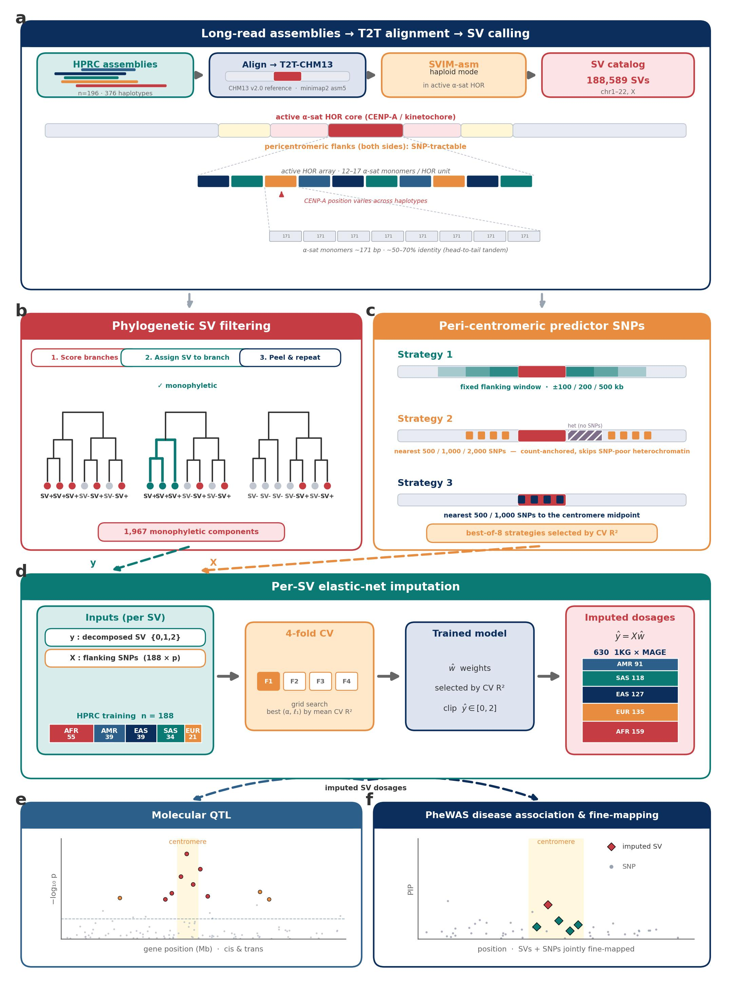
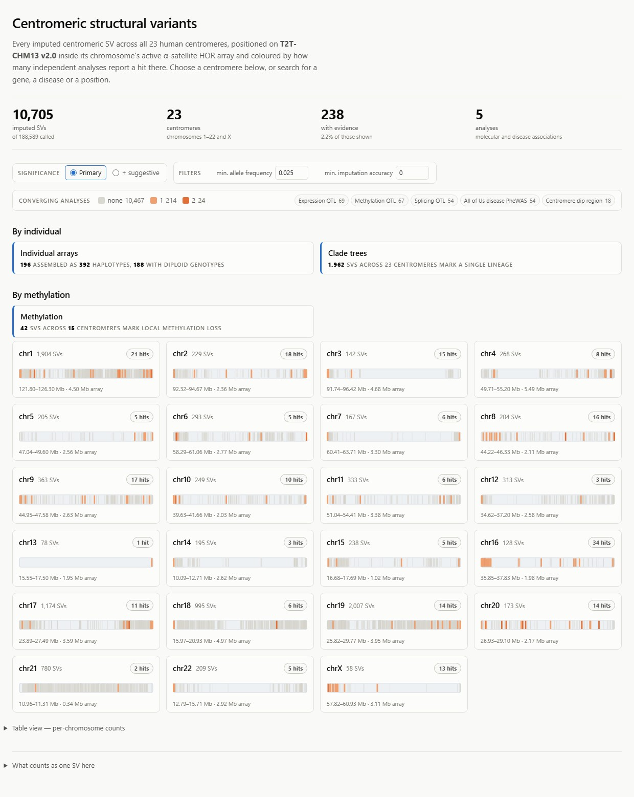
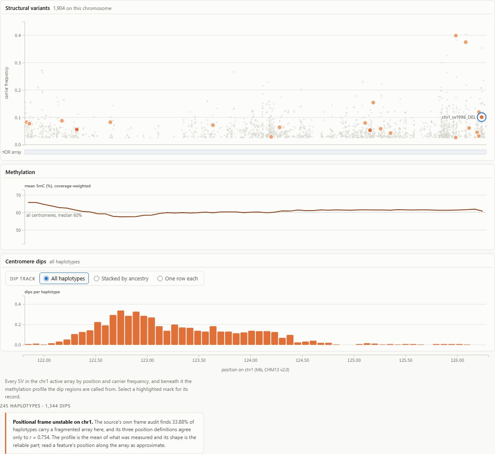

# CenSV

Interactive browser for centromeric structural variation.

*Figure 1 of the preprint. **(a)** Structural variants called inside the active α-satellite
higher-order repeat core of haplotype-resolved HPRC assemblies against T2T-CHM13 — 188,589
across chromosomes 1–22 and X. **(b)** 1,967 monophyletic components resolved from complex
multi-allelic variants. **(c)** Pericentromeric predictor SNP sets under three strategies.
**(d)** Per-SV elastic-net imputation into 630 unrelated 1000 Genomes samples. **(e)** The
imputed variants tested as cis- and trans-QTLs for expression and splicing, **(f)** and for
disease association.*

**CenSV** is the browser over that result: the structural variants, where each sits inside its
chromosome's array on the **T2T-CHM13 v2.0** assembly, and every analysis that reports it. It
accompanies the preprint below, from the [Weinstock Lab](https://github.com/weinstocklab) at
Emory University.

*The browser opens on 23 centromere cards, each coloured by how many analyses report a hit.*

## Browser

**https://yikaidong-git.github.io/CenSV/**

The browser is **open to everyone**. The whole of it is one self-contained page — the
catalog, the annotations, the stylesheet and the application in a single file. Once loaded it
runs entirely inside the tab, offline and stateless, and every view carries an address you can
cite: `#/chr8/30` opens that variant's record.

Requires Chrome 80, Firefox 113 or Safari 16.4 or newer.

*One centromere on a single coordinate — the variants by position and carrier frequency, the
5mC profile, and the dip-density track — with the record a reader has open marked.*

## Contents

| | |
|---|---|
| `index.html` | the browser — markup, stylesheet, application and all seven data files in one file |
| `docs/fig1_workflow.jpg` | Figure 1 of the preprint |
| `docs/overview.jpg`, `docs/record.jpg` | the browser, rendered from the file being published |
| `.nojekyll` | serves the file byte-for-byte through GitHub Pages |

The source, the data pipeline, the verification suites and the deployment live in
[`weinstocklab/CenSV`](https://github.com/weinstocklab/CenSV).

## Cite

> Dong Y, Cutler D, Weinstock JS. **Common centromeric variation associates with molecular and
> complex traits in humans.** *medRxiv* 2026.
> [10.64898/2026.10.09.26365154](https://doi.org/10.64898/2026.10.09.26365154)

Please cite the preprint when you use this browser.

## License

[MIT](LICENSE) for the browser and this repository. Figure 1 above is from the preprint,
© the authors, under
[CC BY-NC-ND 4.0](https://creativecommons.org/licenses/by-nc-nd/4.0/).
